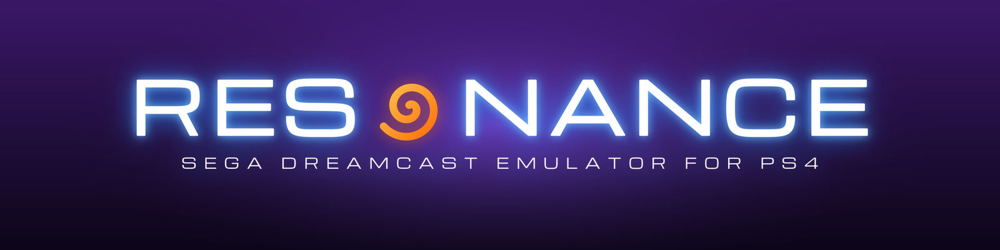

  

  
  
  
  

<h3 align="center">Your Dreamcast library, on the PS4.</h3>

  <a href="https://github.com/iHaiDeeZ/Resonance/releases/latest"><b>⬇ Get the latest version</b></a> ·
  <a href="#getting-started">Getting started</a> ·
  <a href="#controls">Controls</a> ·
  <a href="#game-compatibility">Compatibility</a> ·
  <a href="#faq">FAQ</a> ·
  <a href="CREDITS.md">Credits</a>

---

## Overview

Resonance brings the [Flycast](https://github.com/flyinghead/flycast) emulator to jailbroken PS4
consoles as an app you launch from the home screen like any other. It plays Sega Dreamcast games and
the arcade boards built on it, NAOMI and Atomiswave. You pick a game from a home screen made for
the couch, press **Cross**, and play with your DualShock 4. Pressing **L3 + R3** during a game opens
a quick menu for save states, cheats, discs and settings.

Under the hood, Flycast's recompiler turns the Dreamcast's SH-4 code into x86-64 code for the PS4's
CPU, and rendering goes through Vulkan: Mesa's RADV driver, adapted to submit work directly to the
PS4's AMD GPU.

You bring your own game backups. Nothing copyrighted is bundled: no games and no BIOS files.

## Highlights

**A home screen made for the couch**
- Four themes: **Orbit** (your games as discs on a turning ring), **Channel** (a TV you flip
  through), **Shelf** (boxes on a glossy shelf) and a PS3-style **XMB**. **Square** switches theme.
- Box art is fetched from the libretro thumbnail server, and an opening animation plays at launch.
- New games show up by themselves while the home screen is open; **R3** refreshes the list.
- Games on several discs are one entry that starts on disc 1.
- Menus in 14 languages: English, Español, Français, Deutsch, Italiano, Português, Nederlands,
  Polski, Türkçe, Русский, 日本語, 中文, 한국어 and العربية.

**A quick menu on L3 + R3**
- Resume, ten save-state slots with a picture of each, volume and the FPS counter.
- Cheats & Patches, Change Disc for games on several discs, Settings, Close Game.

**Cheats and patches**
- Cheats download from libretro's cheat database; **patches** (60 fps, widescreen, fixes) download
  from the community's [Flycast cheat chart](https://github.com/nexus382/Flycast-Widescreen-Compatability-And-Cheat-Chart)
  and switch on by themselves.
- Add your own: `.cht` files or GameShark / CodeBreaker code lists, or type codes in on the console.
- Every choice is remembered per game.

**Widescreen without the glitches**
- **Supported games** (the default): about 230 games are patched to draw real 16:9; the rest stay
  in a clean 4:3.
- **Stretch to 16:9**, **All games** (the extra width for every game) or **Off**.
- 2D games (fighters, shooters) always stay in 4:3, where widescreen only shows empty space.

**Every game tuned the way you like**
- Each setting can be global or saved for one game: **Video Settings → Settings For → This Game**.
- **Frame Generation** (experimental): for games that run at 30 fps, a picture made between each two
  frames, so the screen shows 60.

**Arcade games too**
- NAOMI and Atomiswave games take coins: the **touchpad** inserts one.
- **Settings → Arcade Controls** puts every arcade button (1–8, Start, Coin, Service, Test) on the
  PS4 button you choose. The quick menu's **Arcade Buttons** opens a board's operator menu
  (free play, difficulty...).

**Your games, wherever they are**
- **Settings → Game Folders** adds any folder on the console or a USB drive, with a folder browser.
- **Settings → Network Library** reads games from a PC or a NAS over **SMB** or **NFS**.

**And more**
- All four DualShock 4s play, one Dreamcast controller per player, each with a memory card and a
  rumble pack.
- A memory card viewer: see every save with its icon, copy it to another card or delete it.
- Resonance checks GitHub for updates and installs them from **Settings → About**.

## Getting started

**You need:** a jailbroken PS4 with **GoldHEN**, an FTP connection to it, and dumps of games you
own.

1. Grab the latest **`Resonance-vXX.XX.pkg`** from the [releases page](https://github.com/iHaiDeeZ/Resonance/releases/latest)
   and install it with GoldHEN's **Package Installer**.
2. Start **Resonance** once: it creates **`/data/Resonance/`**.
3. Put your games in **`/data/Resonance/games/`**, or add your own folders in **Settings → Game
   Folders**. Dreamcast games can be `.gdi`, `.chd`, `.cdi` or `.cue` / `.bin`; NAOMI and Atomiswave
   games are their `.zip` or `.7z` sets.
4. *Optional:* put the Dreamcast BIOS (`dc_boot.bin`, `dc_flash.bin`) in **`/data/Resonance/data/`**.
   Without it, Flycast's own BIOS replacement is used. Arcade games need their board's BIOS there
   (`naomi.zip`, `awbios.zip`).

> **Tip:** `.chd` is the best format to store Dreamcast games in: one compressed file per disc.

**Updating Resonance:** **Settings → About → Check for Updates**, or install the newer package on
top of the old one. Everything you've set up lives in `/data/Resonance/` and survives updates.

## Controls

### On the home screen

| Press | To |
|---|---|
| D-pad / left stick | Move around |
| L1 / R1 | Jump five games |
| Cross | Play the game / confirm |
| Circle | Go back |
| Square | Switch theme |
| Triangle / OPTIONS | Settings |
| R3 | Look for new games |

### While playing

| Press | To |
|---|---|
| L3 + R3 | Open the quick menu (again, or Circle, to go back) |
| Left / Right in the menu | Change a value |

### Default button layout

| DualShock 4 | Dreamcast controller |
|---|---|
| Cross / Circle / Square / Triangle | A / B / X / Y |
| L2 / R2 | Left / right trigger |
| OPTIONS | Start |
| Left stick | Analog stick |
| D-pad | D-pad |
| Touchpad click | Resonance's menu |

In NAOMI and Atomiswave games, Cross, Circle, Square, Triangle, L1, R1, L2 and R2 are buttons 1–8,
OPTIONS is Start and the touchpad is Coin. **Settings → Arcade Controls** changes them.

## Settings at a glance

| Group | Highlights |
|---|---|
| Video | Settings For (all games or this game), internal resolution, Widescreen, Frame Generation, filtering, frame rate |
| Audio | Volume, sound processor |
| Controllers | The devices in the Dreamcast's ports |
| Arcade Controls | NAOMI / Atomiswave buttons |
| System | Region, language, BIOS, CPU, Cheat Source, Patch Source |
| Home Screen | Theme, menu language, box art, opening animation, Refresh Game List |
| Memory Cards | The cards' saves: look, copy, delete |
| Game Folders | Where Resonance looks for games |
| Network Library | SMB and NFS shares |
| About | Version, credits, updates |

## Your files

Everything the app creates sits in **`/data/Resonance/`**:

- `games/`: your games
- `data/`: BIOS files, memory cards (`vmu_save_*.bin`), save states, box art and `flycast.log`
- `cheats/`: your cheat files (`.cht`, or `.txt` code lists)
- `patches/`: your patches, named after the game's product code (`T13002N.cht`) or its title
- `emu.cfg`: your settings, global and per game
- `boot-trace.log`, `crash.log`: logs for bug reports

## Game compatibility

| Status | Meaning |
|---|---|
|  | Runs well enough to play through |
|  | Gets into the game, but slowdowns or glitches get in the way |
|  | Shows the intro or menus, but doesn't get into the game |
|  | Starts, but stays on a black screen |
|  | Doesn't start, or closes right away |

**Tested by us** on a launch-model PS4, frames per second while playing:

| Status | Game | FPS |
|---|---|---|
|  | Capcom vs. SNK (USA) | 60, full speed. Plays in 4:3. |
|  | Rayman 2: The Great Escape (USA) | 60, full speed |
|  | Sonic Adventure (USA) | 30 in Station Square (its normal rate), full speed. The intro videos run slower. |
|  | Vigilante 8: 2nd Offense (USA) | 60 in the menus, but their background stays black: being looked into. The intro videos run slower. |

A range means the frame rate depends on what's on screen. Tested a game that isn't listed?
[Open an issue](https://github.com/iHaiDeeZ/Resonance/issues) with the game, its region, your
console and firmware, and how it ran.

## FAQ

**Why do videos and intros run slowly?**
Dreamcast games decode their videos on the CPU, the hardest work for the emulator. The game itself
usually runs at full speed afterwards.

**A game's picture has empty or flickering edges.**
Set **Video Settings → Widescreen** to *Supported games* or *Stretch to 16:9*. *All games* draws
past what the game was made to show.

**How do I get a 60 fps patch?**
Patches download by themselves when the [Flycast cheat chart](https://github.com/nexus382/Flycast-Widescreen-Compatability-And-Cheat-Chart)
has one for your disc's region. You can also add one yourself: **L3 + R3 → Cheats & Patches → Add
Patch Code**, or a file in `/data/Resonance/patches/`.

**An arcade game won't take coins.**
Press the touchpad, or set Coin in **Settings → Arcade Controls**. In the board's operator menu
(**L3 + R3 → Arcade Buttons → Test**) you can switch on free play.

**How do I report a bug?**
[Open an issue](https://github.com/iHaiDeeZ/Resonance/issues). Attach `boot-trace.log` and, if
there is one, `crash.log` from `/data/Resonance/` (and `data/flycast.log`), and mention the game,
its region, the Resonance version (**Settings → About**), your PS4 model and firmware.

## Good to know

- Install the `.pkg` once when a release says so: some fixes (like the keyboard's Cross button)
  live in the package, not in the update the app downloads.
- Your saves are on the memory cards in `/data/Resonance/data` and carry over to new versions.
- Only the original PS4 has been tested so far. PS4 Pro reports are welcome.

## Thanks

- **[Flycast](https://github.com/flyinghead/flycast)**: the emulator itself, by **flyinghead** and
  everyone who has contributed to it and to reicast and nullDC before it
- **[Mesa](https://mesa3d.org)**: the RADV Vulkan driver that draws every frame
- **[OpenOrbis](https://github.com/OpenOrbis)** and **[PacBrew](https://github.com/PacBrew)**: the
  PS4 toolchains
- **[libretro](https://github.com/libretro)**: box art and the cheat database
- **[nexus382's Flycast cheat chart](https://github.com/nexus382/Flycast-Widescreen-Compatability-And-Cheat-Chart)**:
  60 fps patches
- **[libsmb2](https://github.com/sahlberg/libsmb2)** and **[libnfs](https://github.com/sahlberg/libnfs)**:
  the network library

Everyone involved, with licences, is listed in **[CREDITS.md](CREDITS.md)**. Building it yourself:
**[BUILDING.md](BUILDING.md)**.

## License and disclaimer

Released under the **GNU General Public License v2.0**, the same licence as Flycast. See
[LICENSE](LICENSE). The home screen and menus are adapted from
[Dolphin for PS4](https://github.com/iHaiDeeZ/DolphinPS4) and [Crema](https://github.com/iHaiDeeZ/Crema).

This is a fan-made project with no ties to Sega, Sony Interactive Entertainment or the Flycast
project. Dreamcast, NAOMI and Sega are trademarks of Sega; Atomiswave is a trademark of Sammy;
PlayStation and PS4 are trademarks of Sony Interactive Entertainment. Please only play games you
own. This project won't help you find or share game files.
